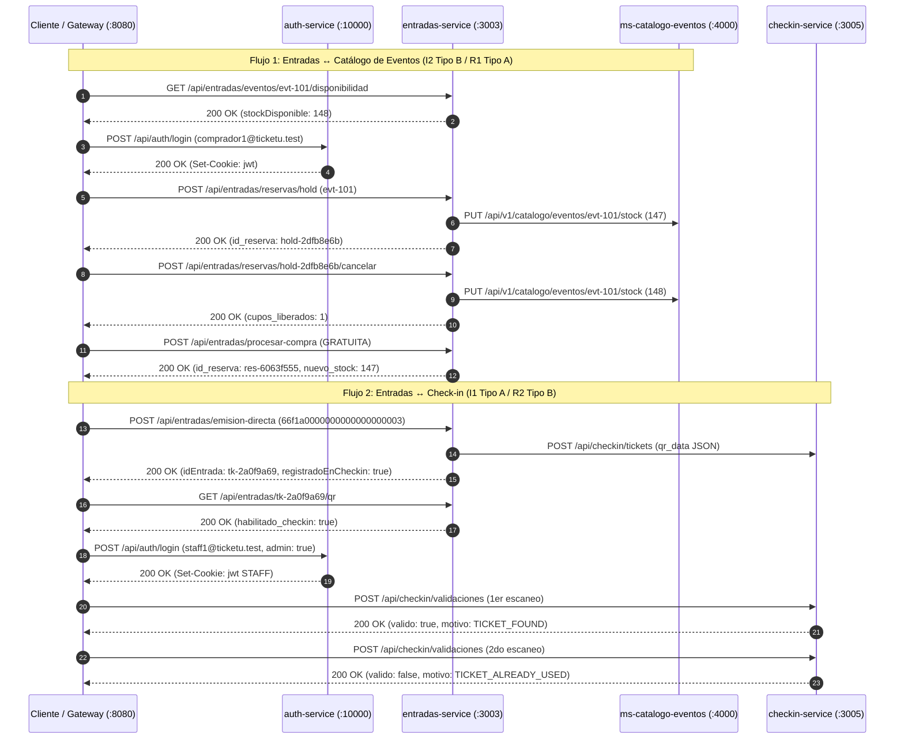

# Demostración de Flujo Backend: Entradas ↔ Catálogo de Eventos y Entradas ↔ Check-in

Evidencia de ejecución real en vivo a través del API Gateway (`http://localhost:8080`) sobre la red Docker `plataforma-eventos-net` con los microservicios **`entradas-service`**, **`ms-catalogo-eventos`**, **`checkin-service`** y **`auth-service`** activos.

---

## Arquitectura del flujo demostrado



---

## 1. Flujo Entradas ↔ Catálogo de Eventos (`I2` Tipo B + `R1` Tipo A)

### 1.1 Consulta de disponibilidad en Entradas (`I2` ofrecido a Catálogo)
**Request:**
```http
GET http://localhost:8080/api/entradas/eventos/evt-101/disponibilidad
```
**Response (`200 OK`):**
```json
{
  "idEvento": "evt-101",
  "stockDisponible": 148,
  "stockTotal": 150,
  "tipoEntrada": "GRATUITA",
  "precio": 0
}
```

### 1.2 Verificación inicial en Catálogo
**Request:**
```http
GET http://localhost:8080/api/catalogo/eventos/evt-101
```
**Response (`200 OK`):**
```json
{
  "id_evento": "evt-101",
  "stock_actual": 148,
  "estado_evento": "disponible"
}
```

### 1.3 Autenticación de comprador en Auth
**Request:**
```http
POST http://localhost:8080/api/auth/login
Content-Type: application/json

{
  "email": "comprador1@ticketu.test",
  "password": "TicketuQA2026!"
}
```
**Response (`200 OK` + Cookie `jwt`):**
```json
{
  "message": "Inicio de sesión exitoso"
}
```

### 1.4 Reserva Hold en Entradas y propagación de stock hacia Catálogo
**Request:**
```http
POST http://localhost:8080/api/entradas/reservas/hold
Content-Type: application/json

{
  "id_evento": "evt-101",
  "cantidad_entradas": 2
}
```
**Response (`200 OK`):**
```json
{
  "hold_id": "hold-2dfb8e6b",
  "id_reserva": "hold-2dfb8e6b",
  "id_evento": "evt-101",
  "id_usuario": "f96e8278-1b2a-4a52-b997-dfeb6e8369a9",
  "nombre_usuario": "Comprador QA 1",
  "rut_usuario": "11.111.111-1",
  "correo_usuario": "comprador1@ticketu.test",
  "cantidad_entrada": 1,
  "monto_total": 0,
  "estado_reserva": "RESERVADO",
  "fecha_creacion": "2026-11-18T19:08:51.643057",
  "fecha_expiracion": "2026-11-18T19:23:51.643057",
  "tiempo_restante_segundos": 900
}
```

**Verificación en Catálogo (`GET /api/catalogo/eventos/evt-101`):**
```json
{
  "id_evento": "evt-101",
  "stock_actual": 147,
  "estado_evento": "disponible"
}
```

### 1.5 Cancelación de Hold y restauración de stock en Catálogo
**Request:**
```http
POST http://localhost:8080/api/entradas/reservas/hold-2dfb8e6b/cancelar
```
**Response (`200 OK`):**
```json
{
  "mensaje": "Reserva cancelada exitosamente y cupos devueltos al pool disponible",
  "id_reserva": "hold-2dfb8e6b",
  "cupos_liberados": 1,
  "id_pago": null,
  "resultado_reembolso_pagos": null
}
```

**Verificación en Catálogo (`GET /api/catalogo/eventos/evt-101`):**
```json
{
  "id_evento": "evt-101",
  "stock_actual": 148,
  "estado_evento": "disponible"
}
```

### 1.6 Procesar compra desde Catálogo (`I2` Tipo B)
**Request:**
```http
POST http://localhost:8080/api/entradas/procesar-compra
Content-Type: application/json

{
  "id_evento": "evt-101",
  "tipo_entrada": "GRATUITA",
  "cantidad": 1
}
```
**Response (`200 OK`):**
```json
{
  "nuevo_stock": 147,
  "id_reserva": "res-6063f555",
  "id_pago": null,
  "estado_pago": "GRATUITA",
  "url_checkout": null,
  "metodo": null,
  "fecha_creacion": null,
  "fecha_expiracion": null
}
```

---

## 2. Flujo Entradas ↔ Check-in (`I1` Tipo A + `R2` Tipo B)

### 2.1 Emisión de entrada y registro en vivo en Check-in (`I1` Tipo A)
**Request:**
```http
POST http://localhost:8080/api/entradas/emision-directa
Content-Type: application/json

{
  "id_evento": "66f1a0000000000000000003"
}
```
**Response (`200 OK`):**
```json
{
  "idEntrada": "tk-2a0f9a69",
  "idEvento": "66f1a0000000000000000003",
  "nombreEvento": "Charla de Ciberseguridad",
  "nombreComprador": "Sebastian Fuentes",
  "correoComprador": "sebastian.fuentes@ticketu.cl",
  "tipoAcceso": "Entrada Gratuita",
  "precioFinal": 0,
  "cantidadEntradas": 1,
  "qrData": "https://api.qrserver.com/v1/create-qr-code/?size=250x250&data=%7B%22id_entrada%22%3A%22tk-2a0f9a69%22%2C%22id_evento%22%3A%2266f1a0000000000000000003%22%7D",
  "fechaEvento": "2026-12-03",
  "horaEvento": "17:00",
  "lugarEvento": "Sala Multiuso, Facultad de Ingeniería",
  "fechaEmision": "18-11-2026",
  "registradoEnCheckin": true
}
```

### 2.2 Consulta de ticket y payload QR (`R2` ofrecido a Check-in)
**Request 1:**
```http
GET http://localhost:8080/api/entradas/tk-2a0f9a69
```
**Response (`200 OK`):**
```json
{
  "id_ticket": "tk-2a0f9a69",
  "nombre_usuario": "Sebastian Fuentes",
  "usuario": {
    "id_usuario": "usr-12345",
    "rol_usuario": "cliente"
  }
}
```

**Request 2:**
```http
GET http://localhost:8080/api/entradas/tk-2a0f9a69/qr
```
**Response (`200 OK`):**
```json
{
  "id_entrada": "tk-2a0f9a69",
  "id_evento": "66f1a0000000000000000003",
  "nombre_asistente": "Sebastian Fuentes",
  "nombre_evento": "Charla de Ciberseguridad",
  "lugar_ingreso": "Sala Multiuso, Facultad de Ingeniería",
  "tipo_acceso": "GENERAL",
  "qr_data": "https://api.qrserver.com/v1/create-qr-code/?size=250x250&data=%7B%22id_entrada%22%3A%22tk-2a0f9a69%22%2C%22id_evento%22%3A%2266f1a0000000000000000003%22%7D",
  "qr_payload": {
    "id_evento": "66f1a0000000000000000003",
    "id_entrada": "tk-2a0f9a69"
  },
  "habilitado_checkin": true
}
```

### 2.3 Autenticación STAFF y validación en puerta (1er y 2do escaneo)
**Login operador STAFF:**
```http
POST http://localhost:8080/api/auth/login
Content-Type: application/json

{
  "email": "staff1@ticketu.test",
  "password": "TicketuQA2026!",
  "admin": true
}
```
**Response (`200 OK`):**
```json
{
  "message": "Inicio de sesión exitoso"
}
```

**1er escaneo en puerta (`POST http://localhost:8080/api/checkin/validaciones`):**
```json
{
  "id_entrada": "tk-2a0f9a69",
  "id_evento": "66f1a0000000000000000003"
}
```
**Response (`200 OK`):**
```json
{
  "valido": true,
  "motivo": "TICKET_FOUND",
  "ticket": {
    "id_entrada": "tk-2a0f9a69",
    "id_evento": "66f1a0000000000000000003",
    "nombre_usuario": "Sebastian Fuentes"
  },
  "evento": {
    "estado_gestion": "PUBLICADO",
    "nombre_evento": "Charla de Ciberseguridad",
    "direccion_evento": "Sala Multiuso, Facultad de Ingeniería",
    "fecha_evento": "2026-12-03",
    "hora_evento": "17:00",
    "hora_fin_evento": "19:00"
  }
}
```

**2do escaneo en puerta (control antifraude):**
```json
{
  "valido": false,
  "motivo": "TICKET_ALREADY_USED"
}
```
