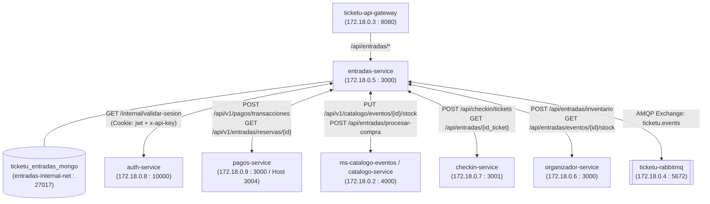

# Informe de Pruebas de Integración y Guía Paso a Paso con Datos Semilla (`entradas-service` ↔ Ecosistema TicketU)

**Microservicio Evaluado:** Entradas e Inventario (`entradas-service`)  
**Red Compartida Docker:** `plataforma-eventos-net` (`172.18.0.0/16`)  
**Red Interna de Datos:** `entradas-internal-net` (aislamiento Database-per-Service para MongoDB)  
**Archivo de Datos Semilla:** [`database/init_db.js`](../database/init_db.js)  
**Fecha de Ejecución:** Noviembre 2026  

---

## 1. Datos Semilla Cargados en `ticketu_entradas_db` ([`database/init_db.js`](../database/init_db.js))

Para que puedas probar el flujo completo sin depender de tokens de sesión expirados ni de reservas borradas por el índice TTL de MongoDB, [`database/init_db.js`](../database/init_db.js) incluye:
1. **Esquema `$jsonSchema` flexible** compatible con todos los campos insertados por [`routers/reservas.py`](../back-end/routers/reservas.py) y [`routers/entradas.py`](../back-end/routers/entradas.py) (`id_evento`, `nombre_evento`, `rut_usuario`, `correo_usuario`, `cookie_header`, `hold_id` y roles en mayúsculas/minúsculas).
2. **Vigencia de 7 días (`expiraEn7Dias`)** para todas las reservas semilla en estado `RESERVADO`, evitando que el índice TTL de MongoDB las elimine a los 15 minutos.

### Cómo recargar o reiniciar los datos semilla en cualquier momento
Si deseas volver al estado inicial limpio antes o después de una demostración, ejecuta en PowerShell desde la raíz del repositorio:

```powershell
Get-Content database/init_db.js | docker exec -i ticketu_entradas_mongo mongosh --quiet
```

### 1.1. Eventos Semilla (`inventario_evento`)
| `id_evento` | `nombre_evento` | `tipo_entrada` | `precio_unitario` | `stock_actual` | Propósito en Pruebas |
|---|---|---|---|---|---|
| `evt-77889` | Concierto Sinfonico TicketU | `PAGADA` | `$10.000` | `144` | Evento principal para Hold, Pagos y Check-in |
| `evt-002` | Charla Abierta de Innovacion | `GRATUITA` | `$0` | `99` | Evento gratuito para emisión directa |
| `evt-101` | Festival Universitario TITEC | `PAGADA` | `$15.000` | `200` | Sincronización de stock con Catálogo (`catalogo-service:4000`) |
| `66f1a0000000000000000002` | Feria de Innovacion TITEC | `PAGADA` | `$10.000` | `300` | Evento sincronizado con Panel Organizador (`organizador-service:3000`) |

### 1.2. Reservas Semilla (`reserva_entrada`)
| `id_reserva` | `id_evento` | `id_usuario` | `estado_reserva` | `cantidad_entrada` | `monto_total` | `id_pago` | Uso directo en el Instructivo |
|---|---|---|---|---|---|---|---|
| `res-98765` | `evt-77889` | `usr-12345` | `CONSOLIDADO` | `1` | `$8.500` | `pay-112233` | Reserva ya pagada con ticket `tk-998877` emitido |
| `res-98766` | `evt-77889` | `usr-54321` | `RESERVADO` | `1` | `$10.000` | `pay-112234` | **Lista para emitir ticket a Check-in** con `POST /api/entradas/reservas/res-98766/webhook-pago` |
| `res-demo-checkin` | `evt-77889` | `usr-12345` | `RESERVADO` | `1` | `$10.000` | `pay-demo-checkin` | **Reserva extra lista para emitir ticket a Check-in** (`webhook-pago`) |
| `res-demo-pagos` | `evt-77889` | `usr-12345` | `RESERVADO` | `2` | `$20.000` | `null` | **Lista para consulta desde Pagos** (`GET /api/v1/entradas/reservas/res-demo-pagos`) |
| `res-demo-cancelar` | `evt-77889` | `usr-12345` | `RESERVADO` | `1` | `$10.000` | `pay-demo-cancel` | **Lista para probar liberación de cupo** (`POST /api/entradas/reservas/res-demo-cancelar/cancelar`) |

### 1.3. Entradas Semilla (`entrada` en MongoDB y `ticket` en MySQL de Check-in)
| `id_entrada` | `id_reserva` | `id_evento` | `id_usuario` | `nombre_usuario` | `estado_entrada` | Estado en MySQL Check-in |
|---|---|---|---|---|---|---|
| `tk-998877` | `res-98765` | `evt-77889` | `usr-12345` | `Sebastian Fuentes` | `EMITIDA` | Registrado (`PENDIENTE`) |
| `tk-demo-001` | `res-98765` | `evt-002` | `usr-12345` | `Sebastian Fuentes` | `EMITIDA` | Registrado (`PENDIENTE`) |

---

## 2. Instructivo Paso a Paso: Comprobar Cambios Bidireccionales entre `Entradas` (MongoDB) y `Check-in` (MySQL)

### Flujo 1: Comprobar que `Entradas` inserta automáticamente un ticket en la BD MySQL de `Check-in`

Tienes **dos opciones** para demostrarlo (la **Opción A** usa directamente la reserva semilla `res-98766` o `res-demo-checkin` sin necesidad de crear un Hold previo):

#### Paso 1.1: Ver el estado inicial de la tabla `ticket` en MySQL de Check-in (`backend-main-db-1`)
```powershell
docker exec backend-main-db-1 mysql -u checkin_user -pcheckin_password checkin_db -e "SELECT id_entrada, id_evento, id_usuario, nombre_usuario, qr_data, estado FROM ticket;"
```
**Resultado inicial:**
```text
id_entrada    id_evento   id_usuario   nombre_usuario      qr_data         estado
tk-998877     evt-77889   usr-12345    Sebastian Fuentes   "tk-998877"     PENDIENTE
tk-demo-001   evt-002     usr-12345    Sebastian Fuentes   "tk-demo-001"   PENDIENTE
```

#### Paso 1.2 (Opción A - Recomendada con Datos Semilla): Consolidar `res-98766` (o `res-demo-checkin`) en Entradas
Puedes hacerlo desde **Swagger UI** (`http://localhost:3000/docs` → `POST /api/entradas/reservas/{id_reserva}/webhook-pago` poniendo `res-98766` en `id_reserva`) o ejecutando en PowerShell:

```powershell
$emit = Invoke-RestMethod -Uri "http://localhost:3000/api/entradas/reservas/res-98766/webhook-pago" -Method Post
$emit
```
**Respuesta de `entradas-service` (`200 OK`):**
```text
message                                                    entradas_emitidas
-------                                                    -----------------
Ticket emitido y notificaciones distribuidas correctamente. {tk-ab577ad8}
```

*(Nota: Si prefieres crear una reserva desde cero con **Opción B** en `POST /api/entradas/reservas/hold`, asegúrate de dejar `"token_sesion": null` para que no intente validar el string `"string"` en Auth:)*
```powershell
$hold = Invoke-RestMethod -Uri "http://localhost:3000/api/entradas/reservas/hold" -Method Post -ContentType "application/json" -Body '{"id_evento":"evt-77889","id_usuario":"usr-12345","nombre_usuario":"Sebastian Fuentes","cantidad":1,"tiempo_limite_minutos":15}'
$emit = Invoke-RestMethod -Uri "http://localhost:3000/api/entradas/reservas/$($hold.id_reserva)/webhook-pago" -Method Post
$emit
```

#### Paso 1.3: Comprobar que el nuevo ticket se guardó en MongoDB (`entradas`) y en MySQL (`checkin`)
1. **En MongoDB de Entradas (`ticketu_entradas_mongo`):**
   ```powershell
   docker exec ticketu_entradas_mongo mongosh ticketu_entradas_db --quiet --eval "db.entrada.find({}, {_id:0, id_entrada:1, id_reserva:1, id_evento:1, id_usuario:1, estado_entrada:1}).toArray()"
   ```
2. **En MySQL de Check-in (`backend-main-db-1`):**
   ```powershell
   docker exec backend-main-db-1 mysql -u checkin_user -pcheckin_password checkin_db -e "SELECT id_entrada, id_evento, id_usuario, nombre_usuario, qr_data, estado FROM ticket;"
   ```
   Verás que el nuevo `tk-...` recién emitido por `entradas-service` aparece insertado en la tabla `ticket` de `checkin_db` con estado `PENDIENTE`.

---

### Flujo 2: Validar Ticket en `Check-in` y Consultar Validez desde `Check-in` hacia `Entradas`

#### Paso 2.1: Validar en puerta un ticket semilla (`tk-998877` o el recién emitido) en `Check-in`
Desde **Swagger de Check-in** (`http://localhost:3001/api-docs` → `POST /api/checkin/validaciones`) o desde PowerShell:
```powershell
Invoke-RestMethod -Uri "http://localhost:3001/api/checkin/validaciones" -Method Post -ContentType "application/json" -Body '{"id_entrada":"tk-998877","id_evento":"evt-77889"}' | ConvertTo-Json -Depth 5
```
**Respuesta de `checkin-service` (`200 OK`):**
```json
{
  "valido": true,
  "motivo": "TICKET_FOUND",
  "ticket": {
    "id_entrada": "tk-998877",
    "id_evento": "evt-77889",
    "id_usuario": "usr-12345",
    "nombre_usuario": "Sebastian Fuentes"
  }
}
```

#### Paso 2.2: Consultar desde el contenedor `checkin-service` hacia `entradas-service` (`GET /api/entradas/tk-998877`)
```powershell
docker exec backend-main-checkin-service-1 node -e "fetch('http://entradas-service:3000/api/entradas/tk-998877').then(async r => console.log(r.status, await r.text()))"
```
**Respuesta obtenida desde `entradas-service` (`200 OK`):**
```json
200 {"id_ticket":"tk-998877","nombre_usuario":"Sebastian Fuentes","usuario":{"id_usuario":"usr-12345","rol_usuario":"cliente"}}
```

---

## 3. Pruebas Rápidas con Datos Semilla para los demás Microservicios

### 3.1. `Pagos` ↔ `Entradas` usando la reserva semilla `res-demo-pagos`
* **Consultar la reserva semilla `res-demo-pagos` desde el contenedor `pagos-service` (Operación 1 - INT-01):**
  ```powershell
  docker exec pagos-service wget -qO- http://entradas-service:3000/api/v1/entradas/reservas/res-demo-pagos
  ```
  **Respuesta (`200 OK`):**
  ```json
  {
    "id_reserva": "res-demo-pagos",
    "hold_id": "res-demo-pagos",
    "id_evento": "evt-77889",
    "id_usuario": "usr-12345",
    "nombre_usuario": "Sebastian Fuentes",
    "rut_usuario": "20.123.456-7",
    "correo_usuario": "sebastian.fuentes@ticketu.cl",
    "cantidad_entrada": 2,
    "cantidad_entradas": 2,
    "monto_total": 20000,
    "total": 20000,
    "id_pago": null,
    "estado_reserva": "RESERVADO",
    "tiempo_restante_segundos": 604795,
    "expirada": false
  }
  ```

* **Cancelar la reserva semilla `res-demo-cancelar` y devolver el cupo al inventario (`POST /api/entradas/reservas/res-demo-cancelar/cancelar`):**
  ```powershell
  Invoke-RestMethod -Uri "http://localhost:3000/api/entradas/reservas/res-demo-cancelar/cancelar" -Method Post -ContentType "application/json" -Body '{"motivo":"Prueba de liberacion con datos semilla"}'
  ```

### 3.2. `Panel Organizador` ↔ `Entradas` usando los eventos semilla `evt-77889` y `66f1a0000000000000000002`
* **Consultar stock de `66f1a0000000000000000002` o `evt-77889`:**
  ```powershell
  Invoke-RestMethod -Uri "http://localhost:3000/api/entradas/eventos/66f1a0000000000000000002/stock"
  ```
  **Respuesta (`200 OK`):**
  ```json
  {
    "id_evento": "66f1a0000000000000000002",
    "stock": 300
  }
  ```

### 3.3. Visualización de Historial y QR de Entradas Semilla (`HU-04` y `HU-05`)
* **Historial del usuario semilla `usr-12345` (`GET /api/entradas/usuario/usr-12345`):**
  ```powershell
  Invoke-RestMethod -Uri "http://localhost:3000/api/entradas/usuario/usr-12345" | ConvertTo-Json -Depth 5
  ```
* **Detalle y QR de la entrada semilla `tk-998877` (`GET /api/entradas/tk-998877/qr`):**
  ```powershell
  Invoke-RestMethod -Uri "http://localhost:3000/api/entradas/tk-998877/qr" | ConvertTo-Json -Depth 5
  ```

---

## 4. Topología de Red y Verificación Integral en Docker



### Comando único para verificar conectividad con todos los microservicios
```powershell
docker exec entradas-service python -c "import urllib.request;
for name, url in [
    ('Auth', 'http://auth-service:10000/'),
    ('Pagos', 'http://pagos-service:3000/api/pagos/health'),
    ('Catalogo', 'http://catalogo-service:4000/health'),
    ('Check-in', 'http://checkin-service:3001/health'),
    ('Panel Organizador', 'http://organizador-service:3000/health'),
    ('API Gateway -> Entradas', 'http://ticketu-api-gateway:8080/api/entradas/health')
]:
    r = urllib.request.urlopen(url, timeout=3)
    print(f'[OK {r.status}] {name}: {r.read().decode().strip()}')"
```
