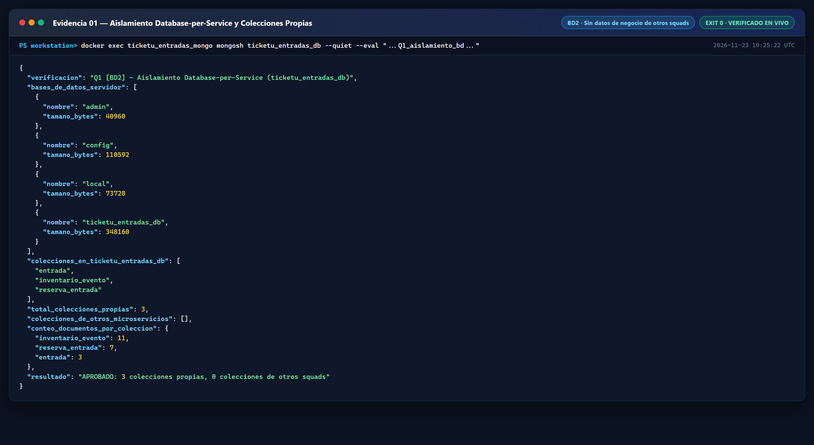
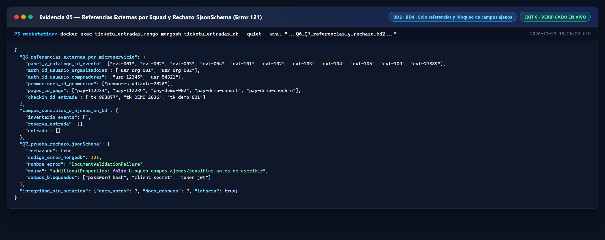
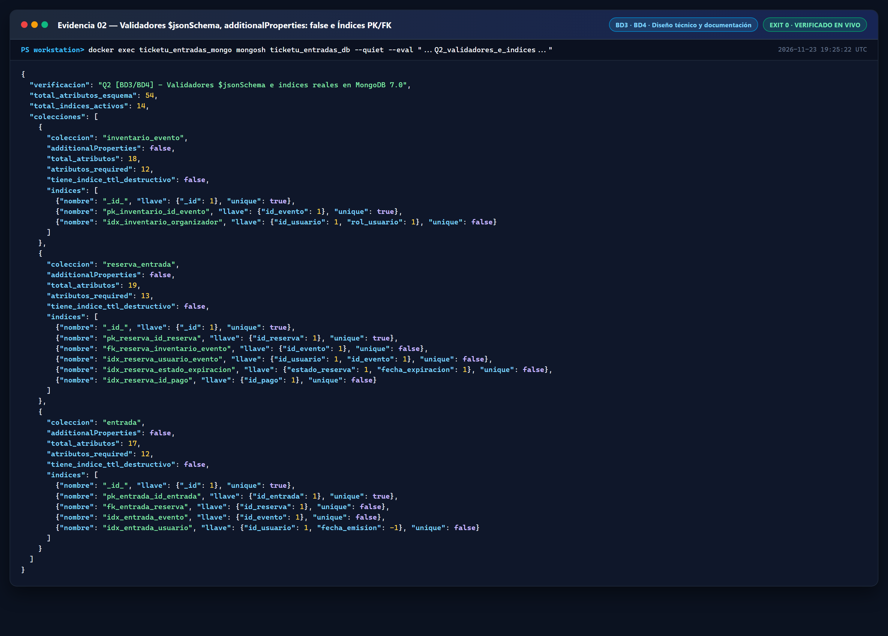
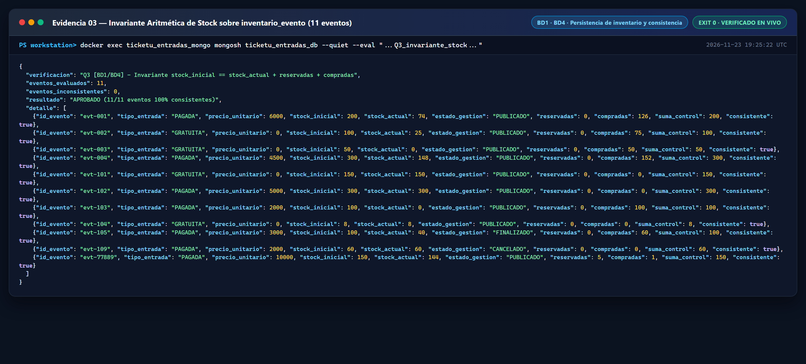
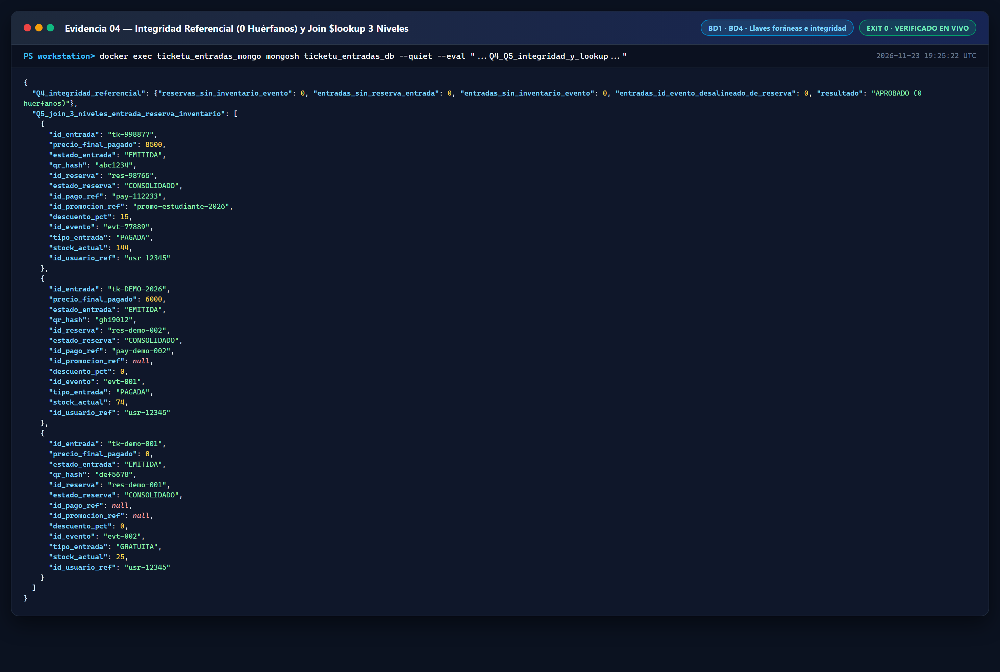
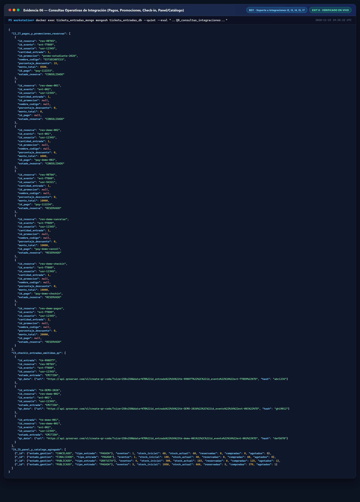
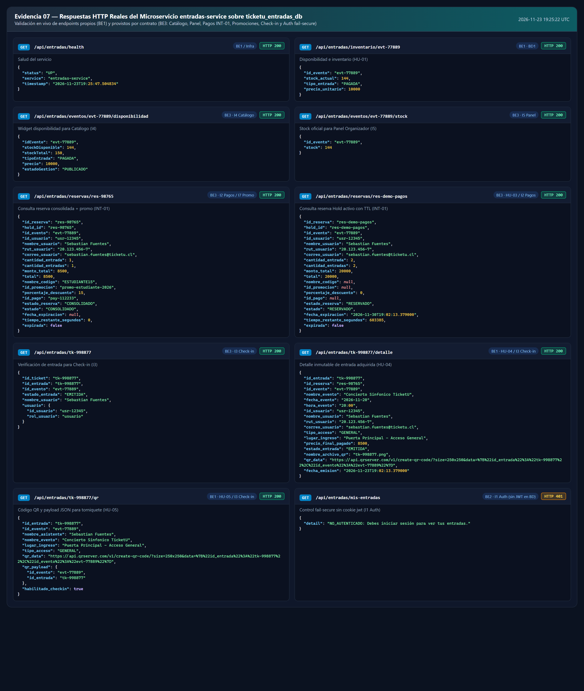
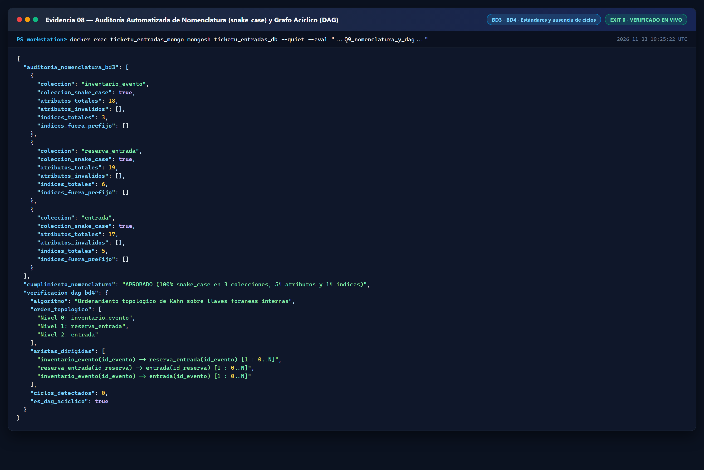

# Documentación Replicable de Funcionamiento, Aislamiento de BD e Integración (`ticketu_entradas_db`)

**Microservicio:** Entradas e Inventario (`entradas-service`)  
**Motor de Base de Datos:** MongoDB 7.0 (`ticketu_entradas_db`)  
**Red interna de datos:** `entradas-internal-net` (aislamiento *Database-per-Service*)  
**Red de integración:** `plataforma-eventos-net` (`ticketu-api-gateway` + `ticketu-rabbitmq`)  
**Criterios de rúbrica verificados:** **BD1**, **BD2**, **BD3** y **BD4**  

---

## 1. Requisitos y Replicación Rápida en Workstation

Esta guía es **100% replicable** en cualquier workstation donde esté desplegado el contenedor `ticketu_entradas_mongo` (con el esquema oficial [`scripts/init_db_creacion_bd.js`](../scripts/init_db_creacion_bd.js)). Ninguna consulta modifica los datos existentes en la base de datos.

### 1.1. Ejecutar la batería completa de 9 consultas en MongoDB (`mongosh`)

**Windows (PowerShell):**
```powershell
Get-Content "documentacion BD\scripts\ejecutar_verificacion_bd.js" -Raw |
  docker exec -i ticketu_entradas_mongo mongosh ticketu_entradas_db --quiet
```

**macOS / Linux (`bash` / `zsh`):**
```bash
docker exec -i ticketu_entradas_mongo mongosh ticketu_entradas_db --quiet < "documentacion BD/scripts/ejecutar_verificacion_bd.js"
```

### 1.2. Regenerar diagrama relacional, diccionario, capturas y PDF desde la BD en vivo

```powershell
# 1. Diagrama vectorial (SVG), PNG alta resolución y DBML
python "documentacion BD\scripts\generar_diagrama_bd.py" --uri "mongodb://127.0.0.1:27017" --db "ticketu_entradas_db"

# 2. Diccionario de datos (Markdown + CSV)
python "documentacion BD\scripts\generar_diccionario_datos.py" --uri "mongodb://127.0.0.1:27017" --db "ticketu_entradas_db"

# 3. Evidencias reales (MongoDB + API) e Informe Centralizado PDF
python "documentacion BD\scripts\generar_evidencias_y_pdf.py" --container "ticketu_entradas_mongo" --uri "mongodb://127.0.0.1:27017" --db "ticketu_entradas_db"
```

---

## 2. Demostración de Aislamiento de BD y Referencias Externas (BD2)

### 2.1. Aislamiento *Database-per-Service* (`Q1`)

La instancia MongoDB del microservicio de Entradas está conectada exclusivamente a la red privada `entradas-internal-net` (sin exposición a otros microservicios en `plataforma-eventos-net`) y contiene únicamente las **3 colecciones propias** del dominio de Entradas (`inventario_evento`, `reserva_entrada`, `entrada`), con **0 colecciones pertenecientes a otros squads**.

```javascript
// Consulta replicable Q1 — Aislamiento y colecciones existentes
const mdb = db.getSiblingDB("ticketu_entradas_db");
printjson({
  bases_de_datos: db.adminCommand({ listDatabases: 1 }).databases.map(d => d.name),
  colecciones: mdb.getCollectionNames().sort(),
  colecciones_otros_squads: mdb.getCollectionNames().filter(
    c => !["inventario_evento", "reserva_entrada", "entrada"].includes(c)
  ),
  conteos: {
    inventario_evento: mdb.inventario_evento.countDocuments(),
    reserva_entrada: mdb.reserva_entrada.countDocuments(),
    entrada: mdb.entrada.countDocuments()
  }
});
```



---

### 2.2. Mapa de Referencias Externas y Ausencia de Credenciales / Secretos (`Q6` y `Q7`)

Toda correlación con otros microservicios se articula mediante **identificadores de referencia externos** (`id_evento`, `id_usuario`, `id_promocion`, `id_pago`, `id_entrada`). No se almacenan tablas de usuarios, contraseñas, cookies `jwt`, `client_secret` de Stripe, reglas de cupones ni registros de validación de torniquete.

| Microservicio contraparte | Identificador de referencia | Colecciones en Entradas | Validación de aislamiento |
| :--- | :--- | :--- | :--- |
| **Auth (I1)** | `id_usuario` | `inventario_evento`, `reserva_entrada`, `entrada` | Introspección HTTP en tiempo real (`GET /internal/validar-sesion`). 0 passwords, 0 cookies `jwt` en MongoDB. |
| **Pasarela de Pagos (I2)** | `id_pago` (y `id_reserva` en INT-01) | `reserva_entrada` | Solo almacena el ID `id_pago`; ignora `client_secret` y no guarda datos de tarjetas ni transacciones Stripe. |
| **Check-in (I3)** | `id_entrada`, `id_evento` | `entrada` (`qr_data`) | Entradas almacena el ticket emitido y su QR; los escaneos y estados de torniquete viven en MySQL de Check-in. |
| **Catálogo de Eventos (I4)** | `id_evento` | `inventario_evento` | Sincronización de stock por `PUT /api/catalogo/eventos/{id_evento}/stock` usando `id_evento`. |
| **Panel Organizador (I5)** | `id_evento`, `id_usuario` | `inventario_evento` | Consumo asíncrono `panel.evento.entradas.v1` y publicación `entradas.evento.stock.v1` / `stock.agotado`. |
| **Notificaciones (I6)** | `id_usuario`, `id_evento` | `entrada` (publicación RabbitMQ) | Publica `entradas_emitidas` en `entradas.events`; sin historial de correos ni plantillas en MongoDB. |
| **Promociones (I7)** | `id_promocion` | `reserva_entrada` | Revalidación server-side vía `POST /api/promociones/evaluar`; sin reglas ni límites de cupones en MongoDB. |

Además, las 3 colecciones aplican validación estricta `$jsonSchema` con **`additionalProperties: false`**. La consulta `Q7` demuestra que al intentar insertar campos ajenos/sensibles (`password_hash`, `client_secret`, `token_jwt`), MongoDB rechaza la escritura con **Error 121 (`DocumentValidationFailure`)** sin alterar la colección (`docs_antes === docs_despues`).

```javascript
// Consulta replicable Q7 — Prueba activa de rechazo $jsonSchema (sin alterar datos)
const antes = db.reserva_entrada.countDocuments();
try {
  db.reserva_entrada.insertOne({
    id_reserva: "res-test-rechazo-bd2", id_evento: "evt-77889", id_usuario: "usr-12345",
    nombre_usuario: "Prueba", rol_usuario: "usuario", cantidad_entrada: NumberInt(1),
    id_promocion: null, porcentaje_descuento: NumberInt(0), monto_total: NumberInt(10000),
    id_pago: null, estado_reserva: "RESERVADO", fecha_creacion: new Date(), fecha_expiracion: new Date(),
    password_hash: "$2b$12$prohibido", client_secret: "pi_secret_prohibido", token_jwt: "jwt_prohibido"
  });
} catch (err) {
  printjson({ rechazado: true, codigo_error: err.code, nombre_error: err.codeName || "DocumentValidationFailure" });
}
print("BD intacta:", antes === db.reserva_entrada.countDocuments());
```



---

## 3. Verificación de Funcionamiento, Integridad Referencial e Integraciones (BD1, BD3, BD4)

### 3.1. Validadores `$jsonSchema` e Índices Verificados sin TTL Destructivo (`Q2`)

Confirma que las 3 colecciones mantienen `additionalProperties: false`, 54 atributos documentados, 14 índices totales (3 PK únicas `pk_*`, 2 FK `fk_*` y 6 índices operativos `idx_*`) y **ningún índice TTL destructivo** sobre `fecha_expiracion` (asegurando que las reservas vencidas siempre devuelvan stock vía worker antes de pasar a `EXPIRADO`).



---

### 3.2. Invariante Aritmética de Stock sobre `inventario_evento` (`Q3`)

Verifica sobre el 100% de los eventos (11 eventos) la ecuación de conservación de inventario:

$$\text{stock\_inicial} = \text{stock\_actual} + \text{cantidad\_entrada\_reservada} + \text{cantidad\_entrada\_comprada}$$

```javascript
// Consulta replicable Q3 — Invariante aritmética de stock
db.inventario_evento.aggregate([
  { $project: {
      _id: 0, id_evento: 1, tipo_entrada: 1, estado_gestion: 1,
      stock_inicial: 1, stock_actual: 1,
      reservadas: "$cantidad_entrada_reservada",
      compradas: "$cantidad_entrada_comprada",
      consistente: { $eq: ["$stock_inicial", { $add: ["$stock_actual", "$cantidad_entrada_reservada", "$cantidad_entrada_comprada"] }] }
  }},
  { $sort: { id_evento: 1 } }
]).toArray();
```

**Resultado verificado:** `11/11` eventos consistentes, `0` desviaciones.



---

### 3.3. Integridad Referencial (0 Huérfanos) y Join Relacional de 3 Niveles (`Q4` y `Q5`)

Valida que:
1. `0` documentos en `reserva_entrada` referencian un `id_evento` inexistente en `inventario_evento`.
2. `0` documentos en `entrada` referencian una `id_reserva` inexistente en `reserva_entrada`.
3. `0` documentos en `entrada` referencian un `id_evento` inexistente en `inventario_evento`.
4. `0` documentos en `entrada` presentan discrepancia entre `entrada.id_evento` y `reserva_entrada.id_evento`.
5. El join `$lookup` completo (`entrada → reserva_entrada → inventario_evento`) reconstruye de punta a punta cada entrada emitida con sus referencias de pago (`id_pago`), promoción (`id_promocion`), usuario (`id_usuario`) y stock del evento.



---

### 3.4. Consultas Operativas por Contrato de Integración (`Q8`)

Demuestra directamente sobre MongoDB que las estructuras persistidas responden a las consultas exigidas por los contratos de integración:
- **Pagos (INT-01) y Promociones (I2 / I7):** reservas `RESERVADO` y `CONSOLIDADO` exponiendo `monto_total`, `cantidad_entrada`, `id_promocion`, `nombre_codigo` (`ESTUDIANTE15`), `porcentaje_descuento` e `id_pago`.
- **Check-in (I3):** entradas `EMITIDA` con `qr_data.url` codificando JSON `{"id_entrada","id_evento"}` y `qr_data.hash`.
- **Catálogo y Panel Organizador (I4 / I5):** agregación por `estado_gestion` (`PUBLICADO`, `FINALIZADO`, `CANCELADO`) y `tipo_entrada` (`PAGADA`, `GRATUITA`), detectando eventos agotados (`stock_actual == 0`).



---

### 3.5. Verificación de Respuestas HTTP Reales del Microservicio (`entradas-service`)

Comprueba de extremo a extremo la lectura real desde `entradas-service` conectado a `ticketu_entradas_db` sobre los contratos provistos (BE1 / BE3) y la política *fail-secure* de Auth (BE2):

| Endpoint probado | Integración / HU | HTTP | Verificación |
| :--- | :--- | :---: | :--- |
| `GET /api/entradas/health` | Infraestructura | `200` | Servicio `UP` |
| `GET /api/entradas/inventario/evt-77889` | BE1 · HU-01 | `200` | Stock (`144`), tipo (`PAGADA`), precio (`10000`) |
| `GET /api/entradas/eventos/evt-77889/disponibilidad` | BE3 · I4 Catálogo | `200` | Disponibilidad y estado `PUBLICADO` |
| `GET /api/entradas/eventos/evt-77889/stock` | BE3 · I5 Panel | `200` | Stock oficial (`144`) |
| `GET /api/entradas/reservas/res-98765` | BE3 · I2 Pagos / I7 Promo | `200` | `total: 8500`, `nombre_codigo: "ESTUDIANTE15"`, `id_pago: "pay-112233"` |
| `GET /api/entradas/reservas/res-demo-pagos` | BE3 · HU-03 / I2 Pagos | `200` | Hold activo (`RESERVADO`), `total: 20000`, `tiempo_restante_segundos > 0` |
| `GET /api/entradas/tk-998877` | BE3 · I3 Check-in | `200` | Validez, `id_evento`, titular y rol |
| `GET /api/entradas/tk-998877/detalle` | BE1 · HU-04 / I3 Check-in | `200` | Detalle inmutable de la entrada adquirida (evento, fecha, lugar, precio y QR) |
| `GET /api/entradas/tk-998877/qr` | BE1 · HU-05 / I3 Check-in | `200` | `qr_payload: {"id_evento":"evt-77889","id_entrada":"tk-998877"}` y `habilitado_checkin: true` |
| `GET /api/entradas/mis-entradas` (sin cookie `jwt`) | BE2 · I1 Auth | `401` | Rechaza `NO_AUTENTICADO` sin consultar ni guardar tokens en BD |



---

### 3.6. Auditoría Automatizada de Nomenclatura y Grafo Acíclico (`Q9`)

Verifica de manera programática que:
- El **100%** de las colecciones (`3/3`) y atributos (`54/54`) cumplen `snake_case` (`/^_?[a-z][a-z0-9_]*$/`).
- El **100%** de los índices (`14/14`) cumplen los prefijos estandarizados (`_id_`, `pk_`, `fk_`, `idx_`).
- Las llaves foráneas conforman un **Grafo Acíclico Dirigido (DAG)** con **0 ciclos** (`Nivel 0: inventario_evento` → `Nivel 1: reserva_entrada` → `Nivel 2: entrada`).



---

## 4. Salida Estructurada Completa

La traza JSON íntegra de todas las consultas MongoDB y respuestas HTTP capturadas se encuentra preservada en [`resultados_ejecucion_consultas.json`](resultados_ejecucion_consultas.json).
